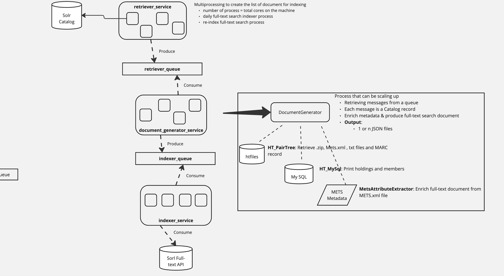
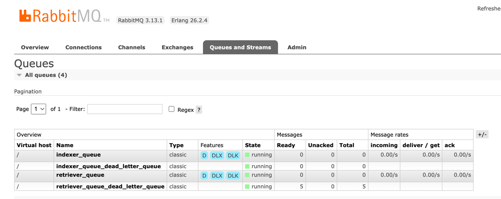
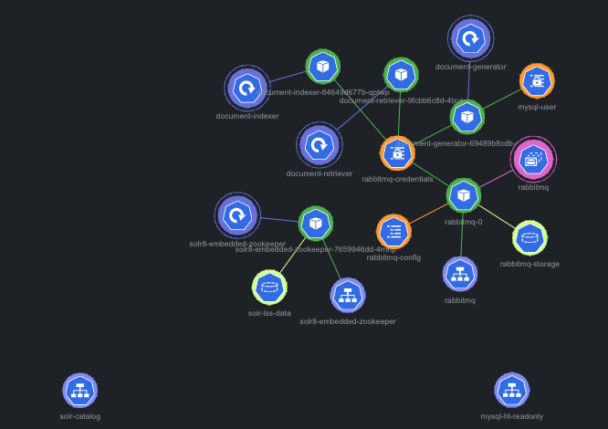

<br/>
  <p align="center">
    ht_indexer
    <br/>
    <br/>
    <a href="https://github.com/hathitrust/ht_indexer/issues">Report Bug</a>
    -
    <a href="https://github.com/hathitrust/ht_indexer/issues">Request Feature</a>
  </p>

## Table Of Contents

* [About the Project](#about-the-project)
* [Built With](#built-with)
* [Phases](#phases)
* [Project Set Up](#project-set-up)
    * [Prerequisites](#prerequisites)
    * [Installation](#installation)
* [Content Structure](#content-structure)
    * [Project Structure](#project-structure)
    * [Site Maps](#site-maps)
* [Design](#design)
* [Functionality](#functionality)
* [Usage](#usage)
* [Tests](#tests)
* [Hosting](#hosting)
* [Experiments](#experiments)
* [Resources](#resources)

## About the Project

Python application for indexing documents in Solr server (fulltext search index) using Docker.

The application contains a component based on [requests](https://docs.python-requests.org/en/latest/) for indexing
documents in a Solr server. The workflow instantiates two solr servers, through docker containers.

* Catalog (solr-sdr-catalog), for retrieving documents and
* Full-text (solr-lss-dev) search index for indexing them.

All the services are started using `docker-compose.yml` file, and it integrates a queue system to communicate the
systems involved in the flow to index documents in Full-text search index. The queue system is based on RabbitMQ.

In `config/global_config` there is a `config.yml` file to set up the different variables that are common for all the services
of `ht_indexer` application. For example, the RabbitMQ URL, RabbitMQ user and password.These variables are also stored
in as environment variables in the `docker-compose.yml` file. The environment variables have precedence over the default
values defined in `config.yml file`.

The application is structured in three main services:
* **document_retriever_service**: Retrieve documents from Catalog index.
* **document_generator**: Generate the document to index in the Full-text search index.
* **document_indexer_service**: Index the documents in Full-text search index.

Each of these services has a queue associated with it to manage the flow of documents to be indexed in Full-text search index.
As each of them has a `config.yml` file to set up the different variables that are specific for each service. 
The `global_config/config.yml` and the per app `config.yml` files are managed by the script `src/ht_queue_service/queue_config.py`
that instantiates a config object with all the variables needed for each service to set up the queue system.

## Built With

* [Python](https://www.python.org/)
* [Docker](https://www.docker.com/)
* [Solr](https://lucene.apache.org/solr/)
* [RabbitMQ](https://www.rabbitmq.com/)
* [MariaDB](https://mariadb.org/)
* [Pytest](https://docs.pytest.org/en/stable/)
* [Poetry](https://python-poetry.org/)

## Phases

* **Phase 1**: Create a FastAPI application to index documents in Solr server
* **Phase 2**: Create services to retrieve and index documents from Catalog index
* **Phase 3**: Integrate a queue system to manage the flow of documents to be indexed in Full-text search index
    * **Phase 3.1**: Split the architecture in three services: document_retriever_service, document_generator, and
      document_indexer_service and use a queue system to manage the flow of documents to be indexed in Full-text search.
* **Phase 4**: Create the MySQL table fulltext_item_processing_status to store the status of the documents
  being processed by the pipeline.
* **Phase 5**: Integrate ht_indexer inside the monorepo repository.
* **Phase 6**: Decoupling queue architecture by refactoring the RabbitMQ queue service components 
to separate connection management, channel creation, and queue management responsibilities.
* **Next steps**:
    * Implement the query to reprocess all the documents in Catalog index.
        * If the list of documents is empty, so do a `--query *:*` and the query_field will be id to retrieve
          all the documents in the Catalog index.
    * Storage the different status of the documents that are being processed by ht_indexer pipeline.
* Phase 7: Use threading instead of multiprocessing in document_retriever_service to improve performance.
  * Decoupling QueueConnection from QueueChannelCreator to create a single TCP connection and multiple channels.
* Phase 8: Propagate the use of config.yml to all the services in the application.
* Phase 9: Refactor the document generator service to improve code maintainability and readability.
  * Added logging and error handling.
  * Modularized the code into smaller functions.
  * Improved configuration management.
  * Enhanced documentation and comments.
  * Optimized performance and resource management.
  * Typed the code using type hints.
* Phase 10: Python dependency management migration from Poetry to UV and docker file refactor to use UV for dependency management and application execution.
  * Refactor the Dockerfile to use UV for dependency management and application execution.
  * Update the documentation to reflect the changes in the dependency management and Dockerfile.

## Project Set Up

* In your local environment, you can use the docker-compose.yml file to set up the services to retrieve and index
  documents in Solr server.

In your workdir:

1. Clone the repository:

   ```git clone git@github.com:hathitrust/ht_indexer.git```
2. Go to the folder ``cd ht_indexer``


3. Run the services

    1. Populate the database with the table fulltext_item_processing_status

       `docker compose up ht_indexer_tracker -d`

    2. Retriever service

       `docker compose up document_retriever -d`

    3. Generator service

       `docker compose up document_generator -d`

    4. Indexer service

       `docker compose up document_indexer -d`

If you want to run the application in your local environment and outside the docker container, you should
follow the steps mentioned in the section [How to set up your python environment](#project-set-up-local-environment)

### Prerequisites

* Docker installed in your local environment
* If you want to run the application outside the docker container, you should set up:
    * the environment variables;
    * Python 3.11 and Poetry installed in your local environment
    * a pairtree-based repository to retrieve the documents to be indexed in Full-text search index.The documents should
      be stored in the folder, and these identifiers should be used to query the Catalog index. Find in section
      [How to create a folder simulating the pairtree-based repository](#creating-local-pairtree-based-repository) tips
      to
      create a pairtree-based repository in your local machine.

## Installation

See the Intallation session on the README.md file on the root directory of this monorepo.

## Content Structure

Four services are available in the application:

* **ht_indexer_monitoring**: Retrieve documents from Catalog to populate the table fulltext_item_processing_status.This
  table is
  used to store the status of the documents being processed by the pipeline.
* **document_retriever_service**: Retrieve documents from Catalog index using.
* **document_generator**: Use the Catalog metadata and the file storage on pairtree-based repository to generate the
  the document to index in Solr.
* **document_indexer_service**: Index the documents in Full-text search index.

Two queues are available in the application to manage the flow of documents to be indexed in Full-text search index.

* **queue_retriever**: Queue to manage the flow of documents to be retrieved from Catalog index.
* **queue_indexer**: Queue to manage the flow of documents to be indexed in Full-text search index.

## Project Structure

The project is structured as follows, separating the source code from the tests. Each service has its own folder.

```
ht_indexer/
├── src/
    ├── catalog_metada/
        │ ├── __init__.py
        │ ├── catalog_metadata.py
    ├── document_generator/
        │ ├── __init__.py
        │ ├── document_generator_service.py
        │ └── document_generator_service_local.py
        | └──test_document_generator.py
        .
        .
        .
├── test/
    ├── catalog_metada_test/
        │ ├── __init__.py
        │ └── catalog_metadata_test.py
    ├── document_generator_test/
        │ ├── __init__.py
        │ ├── document_generator_test.py
        | └──mets_file_extractor_test.py
        | └──mysql_data_extractor_test.py
    .
    .
    .
├── pyproject.toml
├── poetry.lock
├── README.md
```

## Design

The application is structured as follows:



The system that publishes the messages to the queue is called the producer. The system that receives the messages from
the queue is called the consumer. The consumer service implements a mechanism to re-queue the messages that failed.
A message can fail for different reasons:

* The document is not found in the pairtree-based repository.
* The document is not found in the Catalog index.
* The queue system is down.
* The Solr server is down.

We use a **dead-letter-exchange** to handle messages that are not processed successfully. The dead-letter-exchange is
an exchange to which messages will be re-routed if they are rejected by the queue. All the services using the queue
system have a dead-letter-exchange associated with them. For the document indexer, see
[Failures, retries and the dead-letter queue](#failures-retries-and-the-dead-letter-queue) below to learn which messages
end up there and how to replay them.

Find [here](https://www.rabbitmq.com/docs/dlx#overview) more details about dead letter exchanges.

Fine [here](https://github.com/hathitrust/index_search_monorepo/wiki/HT%E2%80%90Indexer:-RabbitMQ-implementation) a detailed
description of the RabbitMQ implementation used in this project.

Each of the defined queues (queue_retriever and queue_indexer) has a dead-letter-exchange associated with it
(retriever_queue_dead_letter_queue and indexer_queue_dead_letter_queue).

The image below shows the queues involved in the system.



When a consumer client receives a message from the queue, it will try to process the message.

* If the message is processed without issues, the message is acknowledged and removed from the queue.
* If the message is not processed, the message is re-queued in the dead-letter-exchange.
  As an example of this logic, you can see the code in the file
    `document_generator/document_generator_service.py` in the function `test_queue_requeue_message_requeue_false()`.

### Failures, retries and the dead-letter queue

The document indexer (`document_indexer_service`) sends each batch of messages to Solr. It does not treat every failure
the same way: a Solr or RabbitMQ outage is not the message's fault, so only a message that can never be indexed is
dead-lettered (ETT-1894).

| What happened                                                       | What the indexer does                                                                                           |
|---------------------------------------------------------------------|-----------------------------------------------------------------------------------------------------------------|
| The whole batch is indexed                                          | Acknowledges every message                                                                                      |
| Solr is unreachable, times out, says it is unavailable (429, 502, 503, 504), rejects our login (401/403), or the URL or core is wrong (404) | Puts the whole batch back on the queue. Nothing is dead-lettered, and a login problem is logged as `config_error` |
| Any other failure of the batch                                      | Retries each document on its own: acknowledges the ones that work, then handles each failure as below           |
| A document alone fails with a 4xx, or with an unknown error          | Dead-letters it (`reason=bad_document`)                                                                         |
| A document alone fails with any other 5xx (e.g. 500)                | Puts it back on the queue. After `max_retries` (default 5, `indexer_config.yml`) it is dead-lettered (`reason=retries_exhausted`) |

So a batch of 3 with 1 bad document gives 2 acknowledgements and 1 dead-lettered message.

* After a batch that put messages back, the service waits before reading again: 1s, 2s, 4s... up to 60s. A clean batch
  resets the wait.
* Only a 5xx answer to a single document, other than 502, 503 and 504, counts towards `max_retries` (Solr answers 500 for
  some bad documents). An outage, including a proxy answering 502/503/504, never uses up a message's retries.
* The retry count is kept in memory, so it starts again from zero when the service restarts.

#### Logs and alerts

Every failure is logged as a structured line, `event=<name> key=value ... error='...'`. Alert rules (Loki) match on these
lines, so do not rename the events or fields without updating the rules. The events and fields are listed in the
`_log_line` docstring in `document_indexer_service/document_indexer_service.py`. To alert on Solr trouble, count the
`event=solr_request_failed` lines where `failure_kind` is not `permanent` (a bad document is not Solr's fault).

#### Replaying the dead-letter queue

Once the cause is fixed (Solr is back, the document is corrected), move the messages back to the indexer queue:

```sh
python -m document_indexer_service.replay_dlq --dry-run   # list what would be replayed, change nothing
python -m document_indexer_service.replay_dlq --max 100   # replay at most 100 messages
python -m document_indexer_service.replay_dlq             # replay everything
```

Run it from the `ht_indexer` virtual environment or container. The queue name comes from `indexer_config.yml`. The
RabbitMQ host, port, username and password come from the `RABBITMQ_INDEXER_RW_*` environment variables, like for the
indexer service. They are already set inside the containers; on your machine, load the repository's `.env` file:
`uv run --env-file .env python -m document_indexer_service.replay_dlq --dry-run`.

* Each message is published to the indexer queue first and removed from the dead-letter queue only after RabbitMQ
  confirms it. If a publish fails, that message stays in the dead-letter queue and the command stops with an error.
* It handles only the messages that were in the dead-letter queue when it started, so a message that fails again
  cannot make it run forever.
* A crash at the wrong moment can leave a message in both queues. That is harmless: Solr overwrites a document that has
  the same `id`.
* If a message fails again, it is dead-lettered again. Check the `event=message_dead_lettered` log lines for the reason.

## Functionality

In all the use cases, a list of documents is received as input. The list of documents could be provided as an input or
retrieved from the MySql table fulltext_item_processing_status.
The list of documents is used to query the Catalog index. The retriever_service retrieves the metadata of each
document from the Catalog index. The user must also provide a parameter indicating the catalog Solr field
used into the query. The Solr query is based on the field `id` or `ht_id`.

The field `id` is used if you want to process all the items on a record. The `ht_id` is used when a specific
item of a Catalog record will be processed.

The Solr query will look like this: `id:100673101` or `ht_id:umn.31951d01828300z`

The Solr terms query parser is used to look up the documents in the Catalog index.
The terms query parser in Solr is a highly efficient way to search for multiple exact values
in a specific field — great for querying by id or any other exact-match field, especially when you're dealing with
large lists.

The Solr query looks like this:

``` 
{ q:*:*,
  fq:{!terms f=ht_id}id1,id2,id3,id4 }
  'rows': 200,
  'wt': 'json'
 ```

In the query `*:*` is used to match everything (or in the future we could implement the use case to add a specific
query string. The list of ids is used as a filter via `fq` to limit the documents by ht_id. The query avoids
scoring computation, which improves performance.

The parameter `rows` is used to retrieve documents in batches of 200 IDs each time.
As we have a long list of ht_ids/ids, we recommend splitting the list of documents into chunks
and creating a query batch to avoid the Solr URI too long error (status code 414).
The chunk size equal 200 was determined by testing the Solr query with different values, e.g., 100-500 and
with 200 ht_ids it worked.

### Use case 1: Generating & indexing one or N items retrieved from Catalog in Full-text search index:

The application receives a list of ids and a parameter that indicates if all the items in a record are processed
or only one item. Three different parts/clients are involved in this process, and the communication among them
is using a queue system.

### Use case 2: Generating & indexing long documents in Full-text search index:

There are some documents that exceed the maximum size of a message allowed by the queue system. In this case, only a
queue containing the metadata extracted from Catalog index is used. After that, the components for generating and
indexing the documents are used in sequence in a local environment.

### Use case 3: Populate retriever_queue using document ids listed in a file:

This use case is implemented by a python script that retrieves the id to populate the queue from a TXT file. This
use case is used to process in Kubernetes a batch of documents selected from production. See the section
``Run retriever service by file`` to find the command to run this use case.

### Use case 4: Populate the table fulltext_item_processing_status with the status of the documents being processed by the pipeline:

The script will query the Catalog index and populate the table with the status of the documents being processed by
the pipeline. See below the sql statement used to create the table fulltext_item_processing_status.

Every time a document is processed, the status of the document is updated in the table. The status of the document can
be one of the following: pending, processing, failed, completed.

* If the document is indexed in Solr status=completed, retriever_status=completed,
  generator_status=completed, indexer_status=completed.
* If the document is not indexed in Solr status=failed, retriever_status=completed,
  generator_status=completed, indexer_status=failed.

```

        CREATE TABLE IF NOT EXISTS fulltext_item_processing_status (
            ht_id VARCHAR(255) UNIQUE NOT NULL,
            record_id VARCHAR(255) NOT NULL,
            status ENUM('pending', 'processing', 'failed', 'completed', 'requeued') NOT NULL DEFAULT 'Pending',
            retriever_status ENUM('pending', 'processing', 'failed', 'completed') NOT NULL DEFAULT 'Pending',
            generator_status ENUM('pending','processing' ,'failed', 'completed') NOT NULL DEFAULT 'Pending',
            indexer_status ENUM('pending', 'processing', 'failed', 'completed') NOT NULL DEFAULT 'Pending',
            error TEXT NULL,
            created_at TIMESTAMP DEFAULT CURRENT_TIMESTAMP,
            updated_at TIMESTAMP DEFAULT CURRENT_TIMESTAMP ON UPDATE CURRENT_TIMESTAMP,
            processed_at TIMESTAMP NULL DEFAULT NULL
        );

```

#### Status guard: services writing out-of-order

The retriever and the generator both write the shared `status` column. They run as separate processes, and
the retriever writes to MySQL only after publishing a whole batch (up to 200 items). So the generator can
finish an item before the retriever records it. Without protection, the later write wins: a retriever
success could turn a generator `failed` back into `processing`.

To prevent this, each stage always writes its own column (`retriever_status`, `generator_status`), but it
only changes the shared `status` column (and `error`) when the row's current `status` allows it:

| Stage     | Always written                        | `status` / `error` only changed when |
|-----------|---------------------------------------|--------------------------------------|
| Retriever | `retriever_status`, `processed_at`    | `status = 'pending'`                 |
| Generator | `generator_status`, `processed_at`    | `status <> 'completed'`              |

The guard is a `CASE` expression inside `SET`, not a condition in `WHERE`:

```sql
UPDATE fulltext_item_processing_status
SET retriever_status = :retriever_status, processed_at = :processed_at,
    status = CASE WHEN status = 'pending' THEN :status ELSE status END
WHERE ht_id = :ht_id
```

A `WHERE` guard would skip the whole row, leaving `retriever_status = 'pending'`. The retriever selects
rows by `retriever_status = 'pending'`, so it would publish the same item again on every polling cycle.
`status` is assigned last in `SET` because MySQL evaluates assignments left to right, and the `error` guard
has to read the original `status`.

#### Reprocessing items that are not `pending`

When you reprocess items that already ran (for example, with `run_retriever_service_by_file.py`), the
retriever records `retriever_status` but leaves `status` and `error` unchanged until the generator writes.
Reset the rows first so they start clean:

```sql
UPDATE fulltext_item_processing_status
SET status = 'pending', retriever_status = 'pending', generator_status = 'pending',
    indexer_status = 'pending', error = NULL
WHERE ht_id IN ('mdp.39015026143126', 'hvd.32044106262314');
```

Also clear `error`: success writes don't reset it, so an old error message would otherwise stay on the row.

## Usage

### All services (Retriever, Generator and Indexer) using the queue message system

* **Run retriever service**

``` 
docker compose exec ht_indexer_tracker python -m ht_indexer_monitoring.ht_indexer_tracktable --env dev --query "*:*" --num_found 100

```

* --query "*:*" It retrieves all the documents on Solr server
* --num_found = 100. It is the number of records to be retrieved. As each record could be 1 or more items and each row
  of
  the table is an item, we will recover more items than the number of records.

* **Run retriever service**

```

docker compose exec document_retriever python -m document_retriever_service.full_text_search_retriever_service
--list_documents
chi.096189208,iau.31858049957305,hvd.32044106262314,chi.096415811,hvd.32044020307005,hvd.32044092647320,iau.31858042938971
--query_field item

```

* **Run retriever service by file**

```

docker compose exec document_retriever python -m document_retriever_service.run_retriever_service_by_file
--query_field item --input_document_file document_retriever_service/list_htids_indexer_test.txt

```

* **Generator service**

```

docker compose up document_generator -d

```

This container will automatically start the script `python document_generator/document_generator_service.py` that will
be retrieving the documents from the retriever_queue and will publish a new message in indexer_queue

* **Indexer service**

```

docker compose up document_indexer -d

```

This container will automatically start the script `python document_indexer_service/document_indexer_service.py` that
will be retrieving the documents from the indexer_queue and will be indexing the documents in the Full-text search
index.

### Retriever writes into the queue and Generator/Indexer run in sequence in the same environment

* **Retriever service receives a list of document ids**

```

docker compose exec document_retriever python document_retriever_service/full_text_search_retriever_service.py
--list_documents
chi.096189208,iau.31858049957305,hvd.32044106262314,chi.096415811,hvd.32044020307005,hvd.32044092647320,iau.31858042938971
--query_field item

```

* **Generator service running locally**

The script ```document_generator_service_local.py``` is used to generate the document to index in full-text search
and to storage the file in a local folder (/tmp) in JSON format.

```docker compose exec document_generator python document_generator/document_generator_service_local.py --document_local_path /tmp --document_repository local```

* **Indexer service running locally**

```document_indexer_local_service.py``` The script should retrieve documents from the /tmp folder for indexing in Solr,
not from the queue.

```docker compose exec document_indexer python document_indexer_service/document_indexer_local_service.py --solr_indexing_api http://solr-lss-dev:8983/solr/#/core-x/ --document_local_path /tmp/indexing_data```

### Processing documents reading the list of ids from a file

Provide a plain-text file with one ID per line. This file is not included in the repository: operators
must supply their own file (for example, generated from a Catalog Solr query).

If any of these items already ran, reset their rows in `fulltext_item_processing_status` first; see [Reprocessing items that are not `pending`](#reprocessing-items-that-are-not-pending).

```docker compose exec document_retriever python document_retriever_service/run_retriever_service_by_file.py --query_field item --input_document_file /path/to/your/htids.txt```

#### Item mode and record mode

`--query_field` decides what the IDs in the file are and what gets indexed:

| `--query_field` | IDs in the file | Solr query | What is published to the queue |
|---|---|---|---|
| `item` (default) | ht_ids, e.g. `mdp.39015078560292` | `{!terms f=ht_id}` | Only the listed items, even when their record has more items |
| `record` | Catalog record ids, e.g. `008394936` | `{!terms f=id}` | Every item (`ht_id`) of each listed record |

Any other value is rejected when the script starts.

#### How the file is read and validated

`read_ids_from_file` (`run_retriever_service_by_file.py`) handles each line in this order:

1. **Strip** spaces, tabs and Windows line endings (`\r`) around the ID.
2. **Skip blank lines.** They don't count as requested IDs.
3. **De-duplicate.** The first occurrence is kept; later repeats are counted as `duplicates` and dropped.
4. **Validate** the ID against the format for `--query_field`. Invalid IDs are logged one per line
   (`Invalid item id 'bad id' in htids.txt: skipped`) and are not sent to Solr.

| Mode | Valid format | Valid examples | Invalid examples |
|---|---|---|---|
| `item` | lowercase namespace, a dot, then an ID with no spaces or commas (`^[a-z0-9]+\.[^\s,]+$`) | `mdp.39015078560292`, `umn.31951001997704p`, `uc2.ark:/13960/t0dv1g69b` | `008394936` (record id), `mdp 123`, `mdp.1,mdp.2`, `MDP.1`, `no_namespace` |
| `record` | exactly 9 digits (`^\d{9}$`) | `008394936`, `100393743` | `mdp.1`, `12345` |

Commas are rejected because Solr's `{!terms}` parser uses them to separate IDs, so one ID with a comma would be
read as two.

#### Processing

The remaining IDs are sent to the retriever in groups of 200. That is the most Solr accepts before it rejects the
request URL as too long (HTTP 414). With `--parallelize`, each group is split across threads. For each group, the
retriever queries Catalog, builds the metadata of each item and publishes one message per item to the
`retriever_queue`. The generator and indexer then process those messages.

Item order is not guaranteed: IDs are de-duplicated against the status file with a set.

#### Run summary

At the end of the run, including when a Solr error stops it partway, the script logs one line:

```
Retriever by file summary: requested=1000 duplicates=3 invalid=2 already_processed=0 seeded=990 errors=1 not_found=4
```

| Field | Meaning |
|---|---|
| `requested` | Non-blank lines in the file |
| `duplicates` | Repeated IDs that were dropped |
| `invalid` | IDs that failed format validation (each one is also logged as an error) |
| `already_processed` | Valid IDs skipped because they are in the status file |
| `seeded` | Items published to the queue |
| `errors` | Items whose catalog metadata could not be built, or whose publish failed. Both are written to MySQL as `retriever_status=failed`. With `--parallelize`, a thread that fails counts all its IDs as errors |
| `not_found` | Requested ht_ids that Catalog did not return (each one is also logged as an error). Always 0 with `--query_field record` |

With `--query_field item`, the fields add up: `requested = duplicates + invalid + already_processed + seeded + errors + not_found`.
With `--query_field record` they don't: `requested` counts record IDs, while `seeded` and `errors` count the items of those records.

The numbers don't always add up to `requested`:
- In item mode, an ht_id that Catalog doesn't return is neither `seeded` nor an `error`.
- In record mode, `seeded` counts items, and one record can have many items.

## Tests

In the working directory,

* Create the image

```docker build -t document_generator .```

* Run ht_indexer_tracker

```docker compose up ht_indexer_tracker -d```

```docker compose exec ht_indexer_tracker python -m pytest ht_indexer_monitoring ```

* Run document_retriever_service container and test it

```docker compose up document_retriever -d```

```docker compose exec document_retriever python -m pytest document_retriever_service catalog_metadata ht_utils ```

* Run document_generator_service container and test it

```docker compose up document_generator -d```

```docker compose exec document_generator python -m pytest document_generator ht_document ht_queue_service ht_utils```

* Run document_indexer_service container and test it

Solr server required authentication, so you should set up the environment variables SOLR_USER and SOLR_PASSWORD before
starting the container. All the users (solr, admin and fulltext) use the same solr password (solrRocks)

export SOLR_USER=admin
export SOLR_PASSWORD=solrRocks

```docker compose up document_indexer -d```

```docker compose exec document_indexer python -m pytest document_indexer_service ht_indexer_api ht_queue_service```

## Hosting

Kubernetes is used to host the application. The application is deployed in MACC HathiTrust Kubernetes cluster in the
namespace `fulltext-workshop`. The application is deployed in the following pods:

* **document-generator**: Service to generate the document to index in Solr.
* **document-retriever**: Service to retrieve documents from Catalog index.
* **ht-indexer-indexer**: Service to index the documents in Full-text search index
* **rabbitmq**: Queue system to manage the flow of documents to be indexed in Full-text search index.
* **solr-embedded-zookeeper**: Full-text search Solr index.

In the image below, you can see the main kubernetes parts running in this workflow.


### How to run the full-text workflow in Kubernetes

* Connect to ht-macc cluster
    * I use [OpenLens](https://github.com/MuhammedKalkan/OpenLens) for this
* In OpenLens terminal:
    * Run the command to get a shell on the document_retriever service
        ``` 
      kubectl -n fulltext-workshop exec deployment/document-retriever -ti -- /bin/bash
      ```
    * Run the python script to retrieve documents from Catalog given a list of ht_ids
         ```
          python src/document_retriever_service/full_text_search_retriever_service.py --list_documents
              chi.096189208,iau.31858049957305,hvd.32044106262314,chi.096415811,hvd.32044020307005,hvd.32044092647320,iau.31858042938971
              --query_field item
        ```
    * Run the python script to retrieve documents from Catalog given a list of ht_ids stored in a file
      ```
      python src/document_retriever_service/run_retriever_service_by_file.py --query_field item
            --input_document_file /path/to/your/htids.txt
      ```
      Provide a plain-text file containing one HathiTrust item ID per line. This file is not included
      in the repository.
    * Run the command below to get a shell on the document_generator service
        ``` 
          kubectl -n fulltext-workshop exec deployment/document-generator -ti /bin/bash
        ```
    Note: document_generator and document_indexer are up and running waiting for documents into the queue.
    * Document generator

         ```
           python src/document_generator/document_generator_service.py --document_repository pairtree
        ```
    * Run the command below to get a shell on the document_indexer service

        ``` 
       kubectl -n fulltext-workshop exec deployment/document-indexer -ti -- /bin/bash
        ```
    * Document indexer
      ```
      python src/document_indexer_service/document_indexer_service.py
              --solr_indexing_api http://fulltext-workshop-solrcloud-headless:8983/solr/core-x/
      ```

    * In Kubernetes, you can also use the script `run_retriever_processor_kubernetes.sh` to run the services to retrieve
      documents and publish them into the queue.

        ```
        ./run_retriever_processor_kubernetes.sh
        ```
    * Example of how to retrieve only 1 document from Catalog index

      ```
      python src/document_retriever_service/full_text_search_retriever_service.py --query ht_id:"pur1.32754063106516"
      --document_repository pairtree
      ```

#### How to access RabbitMQ in Kubernetes

1. Using kubectl exec to get into the running rabbitmq container

   `kubectl -n fulltext-workshop exec -ti rabbitmq-0 -- /bin/bash`

2. See all the available queues and messages
   `rabbitmqctl list_queues`
3. Port forwarding for mgmt interface ==> To access to user interface http://localhost:15672
   `kubectl -n fulltext-workshop port-forward pod/rabbitmq-0 15672`

4. Get user/pass of Rabbitmq
   `kubectl -n fulltext-workshop get secret rabbitmq-credentials -o jsonpath="{.data.default-password}" | base64 --decode`
   `kubectl -n fulltext-workshop get secret rabbitmq-credentials -o jsonpath="{.data.default-user}" | base64 --decode`

## Experiments

1. Indexing one million of documents in the Solr server

Generate a list of 1 million ht_ids by querying the Catalog index (for example, with the
`get_list_ids_from_Solr_results.py` script in the `ht_full_text_search` repository) and save it to a
plain-text file with one ht_id per line. The file is not included in this repository — operators must
supply their own.

The command used to retrieve the documents from Catalog index is:

```python document_retriever_service/run_retriever_service_by_file.py --query_field item --input_document_file /path/to/your/htids.txt
```

This experiment will do in the Kubernetes cluster.

# Resources

Access to the `Resources` session on the `README.md` file in the root directory of this repository.

### Additional use cases

These use cases have been created for experimental purposes. They are not used in the production environment.

#### Creating a TXT file listing ht_id from Catalog index

`python ht_indexer/document_retriever_service/catalog_retriever_service.py --query id:100673101
--output_file ~/tmp/ht_ids.txt`

* By default, the file will be created in the folder the root of the project

#### Retrieving files from pairtree-based repository

`python ~/ht_indexer/document_retriever_service/full_text_search_retriever_by_file.py
--list_ids_path /path/to/your/htids.txt`

#### Indexing the documents in full-text search index

`python3 ~/ht_indexer/document_indexer_service/document_indexer_service.py --solr_indexing_api
http://localhost:8983/solr/#/core-x/ --document_local_path ~/tmp/indexing_data`


### DockerFile explanations

**What is the best python Docker image to use?**
This [post](https://pythonspeed.com/articles/base-image-python-docker-images/) help to make the decision

We are using the python image **python:3.11-slim-bookworm** as based on our docker. See
this [link](https://hub.docker.com/_/python) to have a
look to all the python official Docker images. The image is based on Debian Bookworm, released June 2023.

#### Relevant points to decide the image

* Given the speed improvements in 3.11, more important than the base image is making sure you’re on an up-to-date
  release of Python.
* The official Docker Python image is the absolute latest bugfix version of Python
* It has the absolute latest system packages
* Image system: Debian 12
* Image size: 51MB

The **python:alpine** image was tested, and it worked well, however, I decided to abandon it because it lacks the
package installer pip and the support for installing wheel packages, which are both necessary for installing
applications like Pandas and Numpy. Alpine image is the light one; then we should install several dependencies,
e.g. some compiler packages like GCC, then build the image takes time

### Reference used for python implementation

Parser XML files
https://lxml.de/tutorial.html#parsing-from-strings-and-files
https://pymotw.com/3/xml.etree.ElementTree/parse.html

MySql
https://www.w3schools.com/python/python_mysql_join.asp

SSH + python script + environment variables to pass user/password
https://www.the-analytics.club/python-ssh-shell-commands/#google_vignette

Pypairtree
https://github.com/unt-libraries/pypairtree/tree/master

Mets fields documentation: https://mets.github.io/METS_Docs/mets_xsd_Attribute_Group_ORDERLABELS.html
Best practices for writing Dockerfiles: https://docs.docker.com/develop/develop-images/dockerfile_best-practices/
Docker reference: https://docs.docker.com/engine/reference/builder/#workdir
Interesting discussion about poetry and docker file:
https://stackoverflow.com/questions/53835198/integrating-python-poetry-with-docker/70161384#70161384
https://github.com/python-poetry/poetry/issues/1178
Poetry & docker good reference: https://github.com/max-pfeiffer/uvicorn-gunicorn-poetry/tree/main/build

Recommended python image: https://pythonspeed.com/articles/base-image-python-docker-images/

* Something I want to test in my Dockerfile: Use poetry for the dependency solver and then use pip for installing the
  final wheel. => Use poetry expert to generate requirements.txt file,
  use this blog as a
  reference: https://medium.com/vantageai/how-to-make-your-python-docker-images-secure-fast-small-b3a6870373a0
* See this video to reduce the size of the container: https://www.youtube.com/watch?v=kx-SeGbkNPU

### Command to use the API

Use this curl command to check if the API is ready to use

``curl --location 'http://localhost:8081/ping/'``

Using this prototype, you will be able to index an XML document stored in a data folder inside the server.

Use this curl command to add the XML file

``curl --location --request POST 'http://127.0.0.1:8081/solrIndexing/?path=data%2Fadd' \
--header 'Content-Type: text/plain' \
--data '@'``

Use this curl command to delete the XML file

``curl --location --request POST 'http://127.0.0.1:8081/solrIndexing/?path=data%2Fdelete'``

You can also run the application from your local machine without a docker file using the following command.
However, you will have to set up your python environment.

Use this curl command to query Sorl

``curl http://localhost:9033/solr/catalog/query -d 'json={"query":"ht_id:umn.31951000662660j"}'``

``poetry run python main.py --host 0.0.0.0 --port 8081 --solr_host localhost --solr_port 8983``
